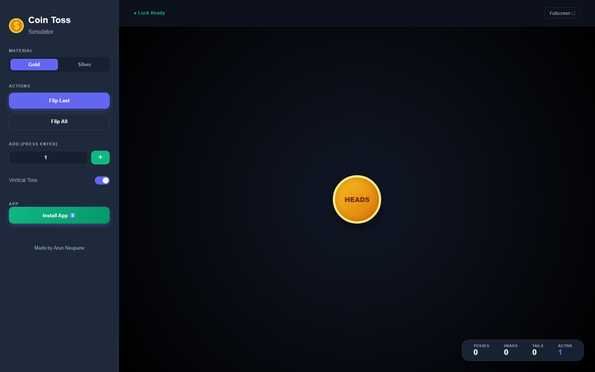
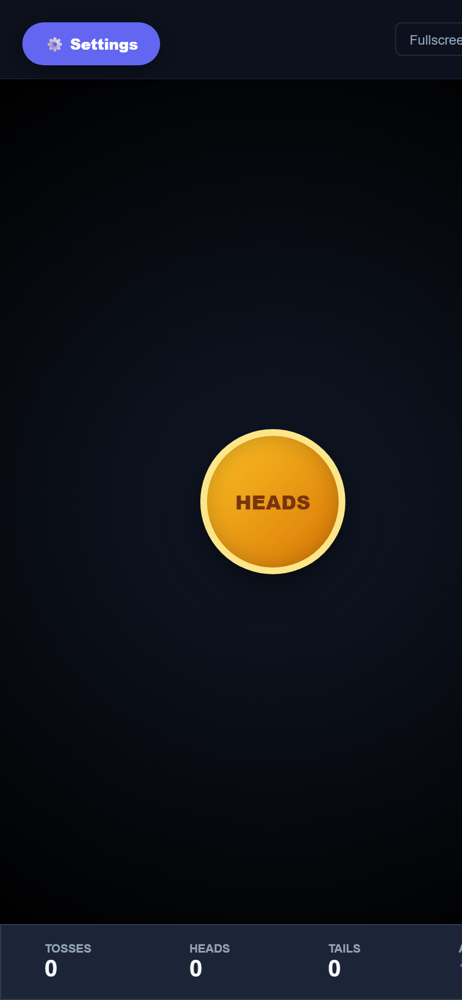

# Coin Toss Simulator

**A coin flip for every decision you never wanted to make.**

Flip realistic coins with smooth 3D animations and sound effects. Decide, gamble, teach probability, or settle arguments - one toss at a time.

## Screenshots

<p align="center">
  
</p>

<p align="center">
  
</p>

## Live Demo

Try it live: [Coin Toss Simulator](https://easyflipping.netlify.app)

Works as an installable PWA - add it to your home screen and use it offline.

## Features

- **Realistic coin toss** - smooth 3D-style flip animation
- **Multiple coins** - add and toss as many coins as you want at once
- **Two toss styles**
  - **In-Place Toss** - the coin spins in place
  - **Vertical Toss** - the coin flips into the air and lands
- **Full-screen mode** - focus on the coins
- **Sound effects** - immersive flip and landing sounds
- **Live statistics**
  - Heads and tails counts
  - Total coins and total tosses
- **Responsive design** - desktop, tablet, and mobile ready
- **PWA support** - installable and works offline via service worker

## How to Use

1. **Toss a single coin** - click the Flip button, or touch the coin.
2. **Add multiple coins** - enter a number and click +, or just click + to add one at a time.
3. **Toss all coins** - click Flip All Coins.
4. **Switch toss style** - toggle between In-Place Toss and Vertical Toss.
5. **Full-screen mode** - click the full-screen icon to enter, and the close icon to exit.
6. **View statistics** - check total coins, total tosses, heads, and tails at the bottom.

## Tech Stack

- **HTML5** - structure
- **CSS3** - styling, animations, and flexbox layout
- **JavaScript** - coin logic, animation, and interactivity
- **Service Worker** - offline support and caching
- **Netlify** - hosting and deployment

## Getting Started

This is a static site. No build step, no package manager, no server needed.

**Option 1:** Open `index.html` directly in any browser.

**Option 2:** Run a local server:

```bash
python -m http.server 8000
```

Then open [http://localhost:8000](http://localhost:8000).

## Project Structure

```
.
|-- index.html       Main HTML file
|-- styles.css       Styling and animations
|-- script.js        Coin toss logic and interactivity
|-- Sounds/          Sound effects
|   |-- coin-flip-shimmer.mp3
|   |-- coin-spinning.mp3
|-- images/          Coin images and previews
|   |-- coin.png
|   |-- coin-flipping.png
|   |-- preview/     README preview images
|-- screenshots/     README screenshots
|-- sw.js            Service worker (PWA offline support)
|-- manifest.json    PWA manifest
|-- README.md        Documentation
```

## Contact

**Arun Neupane** - Frontend Developer, CTO and Lead Architect.

**"I like to code till I don't like to code. (It never happens.)"**

### Connect with Me

- **Website:** [arunneupane.vercel.app](https://arunneupane.vercel.app)
- **GitHub:** [github.com/arundada9000](https://github.com/arundada9000)
- **LinkedIn:** [linkedin.com/in/arundada9000](https://www.linkedin.com/in/arundada9000)
- **X / Twitter:** [x.com/arundada9000](https://x.com/arundada9000)
- **YouTube:** [youtube.com/@arundada9000](https://youtube.com/@arundada9000)
- **Instagram:** [instagram.com/arundada9000](https://instagram.com/arundada9000)
- **Facebook:** [facebook.com/arundada9000](https://facebook.com/arundada9000)
- **Phone / WhatsApp:** [+977 9811420975](https://wa.me/9779811420975)
- **Email:** [arunneupane0000@gmail.com](mailto:arunneupane0000@gmail.com)

Open to collaboration, coding discussions, projects, or just a friendly hello.

## Contributing

This project is proprietary software. Please read [CONTRIBUTING.md](CONTRIBUTING.md) before doing anything.

## Security

Found a vulnerability? Please read [SECURITY.md](SECURITY.md) and report it privately - do not open a public issue.

## License

All rights reserved. This project is **not free for use** and every use requires explicit written permission from the copyright holder. See [LICENSE](LICENSE) for full terms.

---

*It's 50/50 until it isn't.*

---

**Built by Arun Neupane - © 2026 All Rights Reserved**
